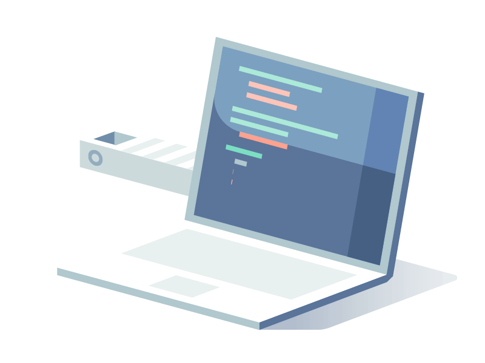

  <!--  -->

  ### I'm Easton 
  #### Software Engineer
   
  
  
  <!--  -->
  

------

  <h3> About Me </h3>

  I build fullstack systems. Recently, MCPs and AI swarms.
  
  I frequently write by hand for the love of the game

  I read my code 😯

  I use AI, it's a good tool

------

  <h3> Work Experience </h3>
  <!--  -->

  <table>
    <tr>
      <th>Experience</th>
      <th colspan="2">Stack</th>
    </tr>
    <tr>
      <td rowspan="3"><b>Alcamo Marketing</b> Software Engineer</td>
      <td>Backend</td>
      <td>
          
          
          
      </td>
    </tr>
    <tr>
      <td>AI</td>
      <td>
          
          
          
      </td>
    </tr>
    <tr>
      <td>Frontend</td>
      <td>
          
          
          
      </td>
    </tr>
    <tr>
      <td rowspan="2"><b>Airballoon</b> Fullstack Engineer</td>
      <td>Backend</td>
      <td>
          
          
          
          <!--  -->
          
      </td>
    </tr>
    <tr>
      <td>Frontend</td>
      <td>
          
          
          
      </td>
    </tr>
    <tr>
      <td rowspan="3"><b>SPACE.P</b> Fullstack Lead Developer / CTO</td>
      <td>Backend</td>
      <td>
          
          
          
          
      </td>
    </tr>
    <tr>
      <td>Frontend</td>
      <td>
          
          
          
      </td>
    </tr>
    <tr>
      <td>Internal</td>
      <td>
          
          
          
          
          
      </td>
    </tr>
    <tr>
      <td><b>AccessSIGCHI</b> Software Engineer Intern</td>
      <td colspan="2">
          
          
          
      </td>
    </tr>
    <tr>
      <td><b>BlockLab Rotterdam</b> Backend Developer Intern</td>
      <td colspan="2">
          
          
          
          
          
      </td>
    </tr>
  </table>

------

<h3>Projects</h3>
  
|   |   |   |   |
|---|---|---|---|
|  | 
   
 |  | 
   
 |
|   |   |   |   |
|  | 
   
 |  | 
   
 |
|   |   |   |   |
|  | 
  
 | 
<b>Under NDA</b>
 | 
   
 |
|   |   |   |   |

------

  <h3>Stats (if you care)</h3>
  
  <!--  -->
  <!--  -->

 

  <h3>mouse user........? I hardly know her.</h3>
  
  
  
  

  
  
  

